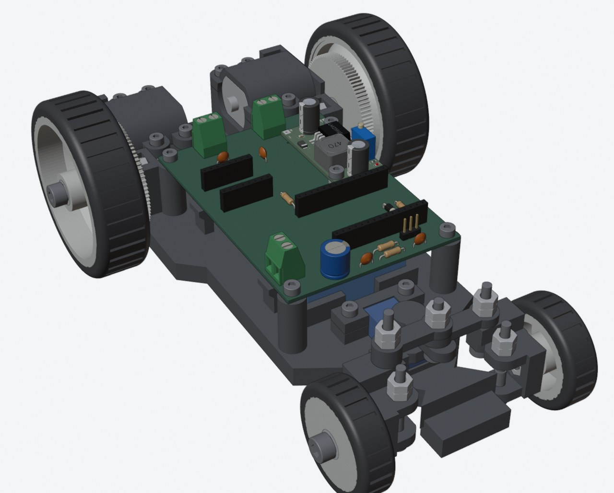
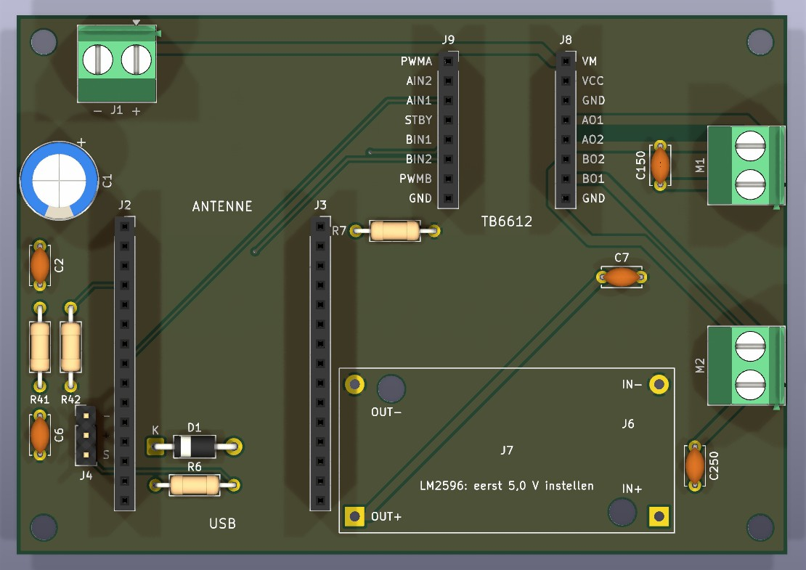
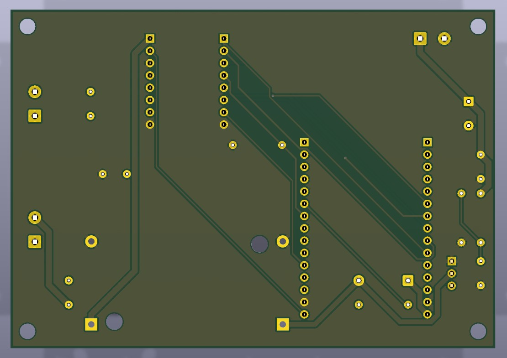
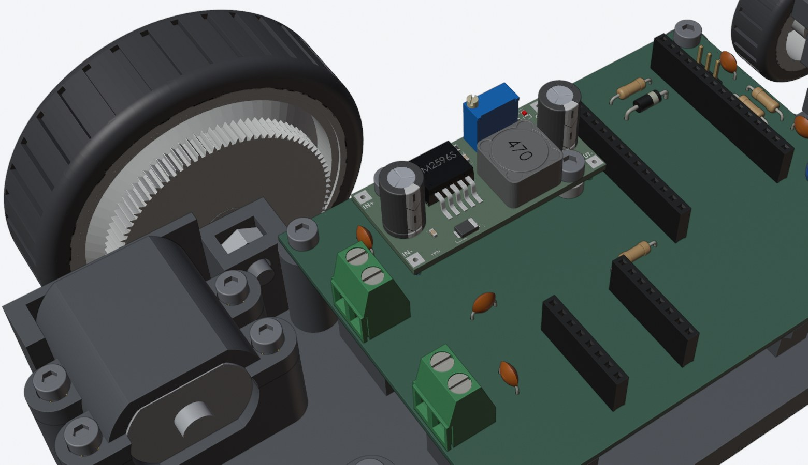

# DIY Auto — V1

RC car: ESP32 + TB6612FNG motor driver, two rear DC motors, servo steering, 2S Li-ion battery.
Everything is generated from code. Edit the script, not the output.

Assembly video: [Video/DIYAuto_assembly_v1.mp4](Video/DIYAuto_assembly_v1.mp4)

## PCB (rev 9)

| Top | Bottom |
|---|---|
|  |  |

The TB6612 module plugs into J8/J9, the ESP32 DevKit into J2/J3. The LM2596 buck module sits on J6/J7 on a printed spacer: set it to 5.0 V before you connect J7.
Order `KiCad/DIY-Auto_rev9_gerbers_PCBWay.zip`.

Schematic: [docs/schematic.svg](docs/schematic.svg) (PDF: [KiCad/DIY-Auto_schema.pdf](KiCad/DIY-Auto_schema.pdf))

## Files

| Folder | What |
|---|---|
| `Scripts/cad/` | SolidCraft CAD (`CAD/DIY-Auto.sc`). Dimensions in `params.py`, `export_sc.py` writes STEP/STL to `CAD/parts/`, `check_all.py` checks collisions, `plates.py` makes print plates. |
| `CAD/` | Generated STEP/STL per subassembly (`print/` = print orientation), print plates (`.3mf`), FreeCAD assembly, `BOM.md`. |
| `Scripts/` | `gen_schematic.py` → `gen_pcb.py` → `route_pcb.py` → `silk_pcb.py` (KiCad), `gen_fritzing.py` (breadboard). |
| `KiCad/` | Schematic, PCB, gerbers. |
| `Fritzing/` | Breadboard layout for testing before the PCB arrives. |
| `Firmware/` | Arduino test sketches (`test_drive`, `test_tb6612`, `pintest`, `debug_hold`). |
| `Video/` | Assembly animation: Blender script (`assembly_anim.py`, steps in `steps.json`) + Remotion title cards. |
| `*.md` | Build notes (Dutch, Obsidian): electronics, mechanics, BOM, assembly, firmware. |

Not included: the SpringRC SM-S2309S servo model (Thingiverse 2835648) and the LM2596 module model used in the renders ([KiCad-Chinese_Modules](https://github.com/yet-another-average-joe/KiCad-Chinese_Modules)), because neither comes with a licence that allows redistribution. Without the LM2596 model, the video script uses the plain box from the CAD.

## Licence

- Code (`Scripts/`, `Firmware/`, `Video/` scripts): [MIT](LICENSE)
- Hardware design (`CAD/`, `KiCad/`, `Fritzing/`, `Drawings/`) and notes: [CERN-OHL-P-2.0](LICENSE-HARDWARE)
